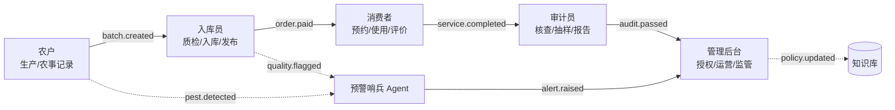
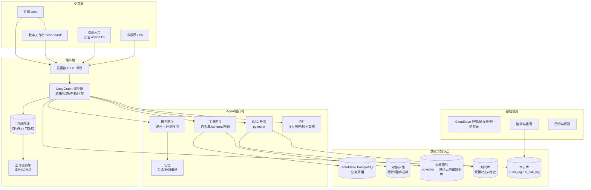
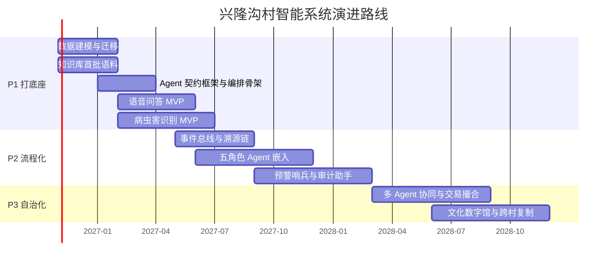

# 兴隆沟村智能系统蓝图（2026—2028）

> 版本：v0.4 · 2026-10 · 编制依据：现有 `web/` + `dashboard/` 代码现状、`docs/wiki`、`docs/architecture`、CloudBase 能力核查与外部资料调研
> 定位：这是一份**演进蓝图**，不是推翻重来。现有五角色工作台是它的骨架，不是原型废弃物。

---

## 0. 一页读懂

**一句话愿景**：把兴隆沟村的服务、物质资源（农产品）、文化资源变成可被感知、编排、监控、交易和监管的数字对象，用一队"知道自己边界"的 AI Agent 辅助村民与村委会，逐步实现节约人力、智能自治、AI 赋能、为人类增智、辅助预警。

**核心方法论**：不是做一个大而全的聊天机器人，而是**角色化 Agent + 契约化边界 + 事件化流转**：

- 每个 Agent 有一张**契约卡**，写死六件事：数据范围、接口范围、业务范围、任务监测点、处理流程、自治等级；
- 所有跨角色协作走**事件总线**（消息队列），不靠页面跳转传递状态；
- 人在回路（human-in-the-loop）是默认状态，自治权按风险逐级授予；
- 运行时知识库建在 CloudBase（PostgreSQL + pgvector），**Qoder 知识中心只服务研发协作，不作为业务 RAG 数据源**。

**三阶段**：

| 阶段 | 周期 | 主题 | 标志性成果 |
| --- | --- | --- | --- |
| P1 打底座 | 0–6 个月 | 数据建模 + 知识库 + 单 Agent 试点 | 方言语音农技问答、病虫害识别 MVP、Agent 契约框架 |
| P2 流程化 | 6–18 个月 | 事件总线 + 多 Agent 嵌入五角色流程 | 溯源链、预警哨兵、入库质检助手、审计助手 |
| P3 自治化 | 18–36 个月 | 多 Agent 协同 + 交易与文化资源 | 交易撮合、文化数字馆、跨村复制 |

---

## 1. 背景与现状盘点

### 1.1 已有资产（可直接复用）

| 资产 | 现状 | 成熟度 | 在蓝图中的角色 |
| --- | --- | --- | --- |
| `web/` 官网 | 内容驱动静态站，含产品、农户故事、资讯、联系方式 | 可用 | 内容 D2C 门面；Agent 内容生产的发布端 |
| `dashboard/` 工作台 | Vue 3 + hash 路由，五角色分区、按区懒加载、路由守卫 | MVP 骨架，多数业务子页为占位 | **Agent 的宿主界面**：每个角色工作台内嵌对应 Copilot |
| `roles-admin` 云函数 | 身份只信 `TCB_UUID`，PG `user_roles` 表，bootstrap 首管 | 可用，安全设计良好 | **权限基座**：扩展为 Agent scope 的授权来源 |
| CloudBase 环境 | 静态托管（官网 + `/app/`）、云函数、PostgreSQL、短信登录 | 生产在用 | 基础设施底座：函数、触发器、PG、存储、托管 |
| `docs/wiki` + `docs/architecture` | 自动维护的项目 Wiki 与流程证据 | 良好 | 研发侧知识；新成员与 Agent 开发者的上下文来源 |
| Qoder 知识中心 / QMind / Sites | Repo Wiki 规划、项目资料库、官网新托管地址 | 已接入 | 研发协作与资料沉淀；**不进入业务运行时** |

### 1.2 现状与目标的差距

| 维度 | 现在 | 蓝图目标 |
| --- | --- | --- |
| 数据 | 仅 `user_roles` 一张业务表 | 地块、作物、批次、订单、服务、文化资源、知识条目、事件、审计八类实体 |
| 流程 | 页面跳转、人工操作 | 事件驱动、Agent 编排、状态机可追踪 |
| 智能 | 无 | 角色 Copilot + 职能 Agent（预警/知识/调度/审核） |
| 权限 | 五角色 RBAC | RBAC + ABAC（归属/地块/批次）+ Agent 显式 scope |
| 监控 | 无 | 任务监测点、审计留痕、质量门禁、告警 |
| 知识 | 散落在文档与人的经验里 | 运行时知识库（政策/农技/村史）+ 向量检索 + 引用可追溯 |

> 技术约束（已核实）：工作台依赖 CloudBase 短信登录、PG、`roles-admin` 三件套；迁移或扩展时应沿用**身份只信服务端上下文**和**前端异常兜底最小权限**两条红线，不要把 Agent 权限做成前端判断。

### 1.3 政策与行业依据（摘要）

| 依据 | 关键内容 | 对蓝图的含义 |
| --- | --- | --- |
| 《数字乡村高质量发展行动计划（2026—2030年）》<br>（中央网信办等，2026-09） | 8 项指标，含 2030 年农村互联网普及率 75%；提出完善农业人工智能标准体系、繁荣乡村数字文化 | 蓝图周期与其重合；Agent 契约与评测体系应对接农业 AI 标准；文化域是政策明确方向，不是锦上添花 |
| 2026 年中央一号文件（2026-02） | "因地制宜发展农业新质生产力，促进人工智能与农业发展相结合""实施数字乡村高质量发展行动" | 农业 AI 是政策主线，P0 优先智能场景 |
| 2025 年中央一号文件（2025-02） | "支持发展智慧农业，拓展人工智能、数据、低空等技术应用场景" | 数据与低空（无人机巡田）可列入后续感知层 |
| 《全国智慧农业行动计划（2024—2028年）》 | 2026 年底农业生产信息化率达 30% 以上（2022 年为 27.6%） | 村级平台需具备生产数据接入与上报能力 |
| 《数字乡村发展战略纲要》（2019） | 2035 年农业农村现代化基本实现 | 长期方向一致，避免重复造轮子 |

**行业基准（用于设定合理预期）**：

- **病虫害识别**：中国农科院公开小程序覆盖 7 类作物、100 多种病害，最低准确率 94.4%（标准场景），拍照到结果不足 2 秒；企业产品在公开报道中的田间实际准确率多在 90% 左右。主要限制是复杂田间背景、标注噪声与私有数据稀缺。→ 本蓝图 P1 目标定为 **Top-3 召回 ≥85%**，不承诺田间 Top-1 准确率。
- **语音**：中国电信已发布支持 30 种方言混说的 ASR 大模型（2024-05），腾讯云 ASR 支持 27 种方言 → 方言语音技术可行，难点在本地术语词表与噪声场景。
- **农村电商**：2025 年农村网络零售额约 3 万亿元、农产品网络零售 7833.1 亿元（同比 +6.7% / +9.9%）→ 交易与供应链数字化有明确市场基础。

---

## 2. 蓝图目标与设计原则

### 2.1 五项目标与可验证定义

| 目标 | 可验证定义（示例指标） |
| --- | --- |
| 节约人力 | 农技咨询平均响应从小时级降到分钟级；入库质检单笔耗时下降 30%+；审计抽样覆盖率从人工 5% 提升到 100% 机器预筛 |
| 智能自治 | 低风险任务（提醒、归档、常规问答、内容草稿）Agent 自动完成率 ≥ 70%；人工接管率逐季下降 |
| AI 赋能 | 每个角色至少 1 个 Agent 深度嵌入日常工作流，而不是独立聊天窗口 |
| 为人类增智 | 高频问答沉淀为知识条目；农户培训完成率与复访率可量化；答案必须带来源引用 |
| 辅助预警 | 病虫害、气象、价格、异常交易四类预警的提前量与误报率可度量，预警必须可解释、可处置、可回访 |

### 2.2 设计原则（硬约束）

1. **人在回路默认开启**：写操作、对外发布、资金/交易相关动作必须人工确认；自治等级逐级授予。
2. **边界先于智能**：Agent 的价值不在"能做什么"，而在"明确不能做什么"。没有契约卡的 Agent 不允许上线。
3. **单一事实源**：业务真相只在 CloudBase PG；知识库解释事实，向量库只是检索索引，任何一层都不能反向覆盖业务库。
4. **事件驱动**：跨角色、跨模块的状态变化必须发事件，禁止用页面轮询或人肉传话。
5. **引用可追溯**：所有面向人的 AI 回答附来源（知识条目 ID / 数据记录 / 规则编号）；无来源的高风险答案必须降级为"建议咨询专家"。
6. **适老化与方言优先**：语音是一等交互方式；界面大字号、少层级、可代操作。
7. **可观测即产品**：每个 Agent 任务的监测点、耗时、失败原因、人工介入记录必须可查、可回放。
8. **离线与弱网可降级**：核心流程（入库、订单查看）在弱网下可用，AI 能力可排队重试。

---

## 3. 业务蓝图

### 3.1 五大业务域

| 业务域 | 核心对象 | 关键动作 | 主要角色 |
| --- | --- | --- | --- |
| 生产域 | 农户、地块、作物、农事记录、病虫害样本 | 种植计划、农事记录、病虫害识别与处置 | 农户（farmer） |
| 流通域 | 产品、批次、质检记录、库存、订单、物流 | 入库、质检、定价、发布、发货 | 入库员（keeper） |
| 消费域 | 消费者、预约、服务、评价、售后 | 浏览、预约、使用、跟踪、评价 | 消费者（consumer） |
| 治理域 | 授权、审计事件、预警、监管上报 | 授权、审计、预警处置、上报 | 审计员（auditor）、管理后台（admin） |
| 文化域 | 村史、非遗、民俗活动、文旅线路、内容 | 采集、编目、讲述、导览、传播 | 全员 + 内容/文旅 Agent |

### 3.2 对象模型（最小可用集）

```
人: 村民/农户/员工/消费者/访客        → user, role_grant(现有), profile
地: 村/地块/海拔/种植面积             → plot, plot_owner
物: 产品/批次/库存/检测报告           → product, batch, inventory, inspection
事: 农事记录/入库/订单/预约/服务工单   → farm_log, intake, order, booking, service_ticket
内容: 农户故事/资讯/知识条目/文化档案   → content_item, knowledge_entry, culture_asset
流: 事件/任务/审批/告警               → event, agent_task, approval, alert
证: 审计事件/操作留痕/模型调用记录     → audit_log, ai_call_log
```

所有实体带 `village_id`（为跨村复制预留）与 `created_at/updated_at`；敏感字段（手机号等）加密或脱敏存储。

### 3.3 业务闭环升级



与原闭环相比，新增三件事：**每个环节产生事件**、**职能 Agent 旁路监测**、**知识库随治理动作更新**。

---

## 4. Agent 体系设计（核心）

### 4.1 两类 Agent

**角色 Agent**（嵌入现有五个工作台，服务一个人类角色）：

| Agent | 服务对象 | 核心能力 | 默认自治等级 |
| --- | --- | --- | --- |
| 农户助手 | farmer | 农技问答、病虫害识别、农事计划、内容草稿、收益解读 | L2 建议 |
| 入库员助手 | keeper | 质检标准查询、批次登记辅助、异常识别、发布文案 | L2 建议 |
| 消费者助手 | consumer | 导购、溯源查询、预约改期、服务跟踪、售后引导 | L2 建议 |
| 审计员助手 | auditor | 异常检测、抽样建议、报告草稿、证据整理 | L2 建议 |
| 管理员助手 | admin | 授权建议、系统健康、运营分析、策略配置 | L2 建议 |

**职能 Agent**（跨角色，后台运行）：

| Agent | 职责 | 触发方式 |
| --- | --- | --- |
| 知识管家 | 知识条目采集、去重、版本、失效检测；政策更新跟踪 | 定时 + `knowledge.gap` 事件 |
| 预警哨兵 | 病虫害、气象、价格、异常交易、舆情监测 | 事件流 + 定时窗口 |
| 调度员 | 订单/服务工单的资源匹配与派发建议 | `order.created` / `booking.created` |
| 内容编辑 | 官网/短视频/播报文案生成与合规检查 | 人工请求 + 内容事件 |
| 合规审查 | 输出审核、隐私检测、监管口径核对 | 所有对外输出前置 |

### 4.2 Agent 契约卡（六要素）

每张契约卡是一份机器可读 + 人可审的配置（建议 YAML 入库，签名后生效）：

| 要素 | 回答的问题 | 落地方式 |
| --- | --- | --- |
| 数据范围 | 能读哪些表/字段/行？知识域有哪些？ | 行级过滤（归属/地块/批次）+ 字段掩码 + 知识域标签 |
| 接口范围 | 能调哪些工具/云函数？读写？限额？ | 工具白名单 + 参数 schema 校验 + 速率/额度限制 |
| 业务范围 | 能做什么、禁止做什么、何时升级给人？ | 允许动作清单 + 禁止清单 + 升级条件 |
| 任务监测点 | 在哪些节点留痕、度量、告警？ | 标准监测事件（见 6.2）+ 阈值 |
| 处理流程 | 从接收到交付经过哪些状态？ | 显式状态机，非法跃迁直接拒绝 |
| 自治等级 | 哪些动作可自动执行？ | L1–L4 分级 + 审批矩阵 |

### 4.3 契约卡示例：农户助手（farmer-copilot）

```yaml
agent: farmer-copilot
version: 1.0.0
objective: 辅助农户完成农事记录、病虫害初判与种植知识学习
data_scope:
  tables:
    - farm_log: { row_filter: "plot.owner_uid = caller.uid", read: true, write: true }
    - plot:     { row_filter: "owner_uid = caller.uid", read: true }
    - batch:    { row_filter: "plot_id IN caller.plots", read: true }
    - knowledge_entry: { domains: [农技, 政策, 病虫害], read: true }
  masking: [phone, id_card, buyer_address]
tool_scope:
  allow:
    - pest.detect            # 只读推理，返回 Top-3 + 置信度
    - knowledge.search       # 只读，强制返回引用
    - farm_log.create_draft  # 写草稿，不直接入账
    - content.draft          # 只生成草稿
  deny: [order.refund, user.grant, price.update, anything.raw_sql]
  limits: { calls_per_task: 8, tokens_per_day: 60000 }
business_scope:
  allowed: [农事记录, 病虫害初判, 种植知识问答, 内容草稿]
  forbidden: [给出农药剂量处方（仅引用官方标准并提示咨询农技员）, 承诺价格, 代下单]
  escalate_when:
    - 病虫害置信度 < 0.75
    - 问题涉及用药安全或纠纷
    - 用户连续两次表达不满
monitoring_points:
  - task.received
  - plan.ready
  - tool.invoked / tool.failed
  - answer.rendered（带引用率）
  - human.confirmed / human.overrode
  - task.closed
process_state_machine: received -> understood -> planned -> executed -> verified -> delivered -> closed
autonomy: L2
approval_matrix:
  read_only: auto
  draft_write: auto_with_audit
  finalized_write: human_confirm
evaluation:
  golden_set: agri-qa-v1（≥300 条，含方言转写）
  gates: { citation_rate: ">=0.95", unsafe_answer_rate: "<=0.5%", pest_top3_recall: ">=0.85" }
```

### 4.4 编排与协作

- **任务总线**：Agent 之间不直接互调，统一通过事件（见 5.3）与任务队列协作；
- **升级机制**：Agent 遇到低置信度、越界请求、连续失败时，按契约升级到人（生成待办卡片，附上下文与建议）；
- **冲突仲裁**：两个 Agent 建议冲突时（如定价 vs 预警），以业务规则库优先级裁决，并记录仲裁日志；
- **幂等与重试**：每个任务带 `task_id`，写操作幂等键唯一，重试不重复扣库存/发通知。

### 4.5 自治等级与审批矩阵

| 等级 | 定义 | 适用动作 | 审批 |
| --- | --- | --- | --- |
| L1 辅助 | 人操作，Agent 仅提供信息 | 查询、说明、检索 | 无需 |
| L2 建议 | Agent 给出建议/草稿，人确认后生效 | 草稿、方案、初判 | 人工确认 |
| L3 自动（低风险） | 满足条件自动执行，事后可撤销 | 提醒、归档、标签、常规通知 | 事后抽检 |
| L4 自治（受控） | 在额度与规则内自动执行 | 低额调度、常规补货建议落地 | 规则 + 审计 + 熔断 |

> 晋升规则：同一动作连续 4 周达到质量门禁且无重大事故，可申请从 L2 升 L3；L4 必须经村委会与审计员双签。

---

## 5. 技术架构

### 5.1 分层架构



**部署形态（ADR-008）**：请求面（CRUD、鉴权、webhook）走无状态云函数；**Agent 运行面走长驻容器**（CloudBase 云托管优先，TKE 备选），支持 WebSocket/SSE。每个 `thread_id` 对应一个会话 Actor：单写者、邮箱串行、独立状态；检查点落 PostgreSQL，崩溃后从最近检查点恢复。默认逻辑隔离，高价值或监管会话可选独占实例。

### 5.2 基础设施选型（阶梯式，避免一步到位）

| 能力 | P1 起步（0–6 月） | 规模化（P2/P3） | 依据 |
| --- | --- | --- | --- |
| 业务库 | CloudBase PostgreSQL（现有） | 同左 + 读写分离/备份策略 | 现有环境自带 |
| 向量检索 | **CloudBase PostgreSQL + pgvector**（官方支持启用扩展，写 ingest/retrieve 云函数跑通 RAG） | 腾讯云向量数据库（10 亿级向量、毫秒级检索、99.99% 可用） | pgvector 官方文档；向量库产品文档 |
| 消息队列 | CloudBase 定时触发器 + 数据库触发器 + 云函数（够 MVP） | **CKafka Serverless** 或 TDMQ CMQ（高吞吐/金融级可靠按场景） | 腾讯云 MQ 选型文档 |
| 语音 | 腾讯云 ASR（支持 27 种方言）+ TTS；混元 Hy ASR 3.0 提升方言与上下文准确率 | 同左 + 自建术语词表/热词 | ASR 产品文档、Hy ASR 3.0 报道 |
| Agent 编排 | **LangGraph 1.x（TypeScript 优先）+ PostgreSQL Checkpointer** | 同左 + 容器化运行时（若云函数受流式/长任务限制） | ADR-007；人工中断落库、thread_id 恢复 |
| 模型 | 通用大模型 + 多模态模型（病虫害识别） | 模型网关统一路由、降级与成本控制 | CloudBase 2026 AI-Native 全栈能力 |
| Agent 运行时 | **CloudBase 云托管（容器，WebSocket/SSE）** | TKE / 腾讯云 Agent Runtime（评估） | ADR-008；请求面仍用云函数 |
| 托管 | CloudBase 静态托管（官网 + 工作台） | 同左；Qoder Sites 作为预览/备用入口 | 现状 |
| 监控 | 结构化的任务监测事件 + 告警 | 指标看板 + 追踪回放 | 自建 |

> 明确边界：**pgvector 是起步方案，不是终局**。当知识条目 > 10 万或检索 QPS 明显上升时，再迁腾讯云向量数据库，检索接口保持不变（适配层隔离）。

### 5.3 事件与主题设计（第一版）

| 主题 | 生产者 | 主要消费者 | 用途 |
| --- | --- | --- | --- |
| `farm.log.recorded` | 工作台/农户助手 | 审计、知识管家 | 农事留痕、产量预估 |
| `pest.detected` | 病虫害识别工具 | 预警哨兵、农户助手、审计 | 病虫害趋势与处置跟踪 |
| `batch.created` | 入库员助手 | 溯源链、库存、审计 | 批次与库存真相 |
| `quality.flagged` | 质检工具 | 入库员、预警哨兵、审计 | 质量异常 |
| `order.created/paid/shipped` | 消费域 | 调度员、审计、通知 | 交易流转 |
| `booking.created/changed` | 消费域 | 调度员、消费者助手 | 服务预约 |
| `service.completed` | 消费域 | 审计、评价沉淀 | 服务闭环 |
| `alert.raised/acknowledged` | 预警哨兵 | 管理员、审计、相关角色 | 预警处置闭环 |
| `knowledge.updated/gap` | 知识管家 | 所有 RAG 消费者 | 知识新鲜度 |
| `agent.task.*` | 编排器 | 监测、审计 | 任务监测点 |

事件规范：`event_id`、`type`、`version`、`occurred_at`、`village_id`、`actor`（人或 agent）、`trace_id`、`payload`、`schema_version`。**事件只增不改**，版本化演进。

### 5.4 数据架构

- **业务库（真相）**：CloudBase PG；所有写操作经工具/云函数，禁止 Agent 直连 SQL；
- **对象存储**：现场照片、语音、视频、检测报告；元数据入库，文件地址签名访问；
- **知识库**：`knowledge_entry`（标题/正文/来源/生效期/适用域/版本/审核人）+ 分块表 + 向量列；
- **审计库**：`audit_log`（业务动作）、`ai_call_log`（模型/工具调用、输入输出摘要、token、时延、引用）；
- **数据血缘**：每条 AI 结论记录用到的知识条目 ID 与业务记录 ID，支撑追溯与纠错。

### 5.5 既有资产如何演进（不推倒重来）

| 资产 | 演进方式 |
| --- | --- |
| `web/` 官网 | 内容模型扩展 `culture`/`trace` 区块；Agent 只产出草稿，人工审核后构建发布 |
| `dashboard/` 五角色 | 每个角色 Shell 增加 Copilot 侧栏；占位子页按 P1/P2 顺序落地；路由守卫增加 `meta.autonomy` 提示 |
| `roles-admin` | 保持"身份只信 TCB_UUID"；新增 `agent_scope` 表（agent_id → 数据/工具白名单），由 admin 授权 |
| 运行面与请求面 | 请求面云函数保留业务 CRUD/鉴权/webhook；`agent-orchestrator` 与 `tool-gateway` 部署在长驻容器；`rag-ingest` 作为异步任务，`rag-retrieve` 作为运行面工具，`event-dispatcher` 由云函数或消费者承担（ADR-008） |
| `docs/wiki` / 知识中心 | 研发知识：架构、契约卡版本、评测结果；**不承载业务 RAG** |
| QMind | 政策/调研/需求的原始资料库，知识管家的**离线语料来源**之一（人工审核后入库） |
| Qoder Sites | 官网预览/演示/灰度入口；正式域名仍以 CloudBase 为准（待定） |

### 5.6 现成能力的使用策略（不自研大模型）

**核心决策**：推理用现成模型，知识用 RAG，只有本地评测证明不够用时才微调轻量视觉模型；**不训练大语言模型**。

| 能力 | 默认方案 | 资源 | 触发 / 限制 |
| --- | --- | --- | --- |
| 病虫害识别 | 调用现成 API/MCP | 神农大模型 4.0（中国农大，2026-07）：1016 种、官方口径 93%+、开放 API + MCP、支持方言交互 | 本地 50–100 张实拍复测 Top-3 <80% 时，才进入微调 |
| 农技问答 | 模型 API + RAG 引用 | 神农 4.0 为主，农科小智备选；语料仅限政策原文、权威农技、村情审核条目 | 无引用的高风险答案降级；案例、推广稿不入库 |
| 语音交互 | 现成 ASR/TTS | 神农方言交互 + 腾讯云 ASR（27 种方言）兜底 | 本地口音必须实测，不能只看宣传 |
| 视觉模型微调（条件触发） | 微调轻量视觉模型 | AI Challenger 2018（61 类 / 47,393 张）、IP102（102 类 / 75k+）、PlantVillage（54,306 张）、IDADP | 只训视觉模型；数据集许可与商用条款逐项核实 |

**三条红线**：

1. 准确率一律以本地实拍评测为准，厂商口径只作参考；
2. 第三方 API 先核验商用条款、数据出域与留存政策，再上线；
3. 案例、竞品、推广稿只存档，不进入运行时知识库。

**供应商可替换**：模型网关保持统一接口，神农 / 农科小智 / 通用多模态 / 自训模型均可切换，避免单一供应商锁定。

---

## 6. 数据治理与安全

### 6.1 权限模型

- **RBAC**：沿用五角色（`farmer/keeper/consumer/auditor/admin`）；
- **ABAC**：地块归属、批次归属、订单归属、服务工单归属决定行级可见性；
- **Agent Scope**：在 RBAC+ABAC 之上再收窄一层；Agent 的权限 = 人类角色权限 ∩ 契约卡 scope，**取交集，永不放大**；
- **服务端裁决**：所有权限判断在云函数侧完成，前端只做展示与引导（沿用现有红线）。

### 6.2 任务监测点（标准事件）

每次 Agent 任务至少产生以下监测事件，字段统一：

| 监测点 | 何时产生 | 关键字段 |
| --- | --- | --- |
| `agent.task.received` | 任务进入 | task_id, agent_id, actor, channel, trace_id |
| `agent.plan.ready` | 规划完成 | steps, tools_planned, risk_level |
| `agent.tool.invoked` | 工具调用前/后 | tool, params_digest, result_status, latency_ms |
| `agent.guard.triggered` | 护栏拦截 | rule_id, reason, action_taken |
| `agent.human.required` | 升级给人 | reason, suggested_action, deadline |
| `agent.human.override` | 人改写了建议 | diff_summary, operator |
| `agent.task.closed` | 交付/关闭 | outcome, citations, tokens, cost |
| `agent.heartbeat` | 长任务定时 | progress, last_step |

告警阈值示例：任务成功率 < 95%、人工接管率突增 50%、工具失败率 > 5%、平均时延 > 30s、单日 token 成本超预算 120%。

### 6.3 隐私与合规

- 数据分级：公开（官网内容）/ 内部（运营数据）/ 敏感（手机号、地址、交易）/ 监管（审计证据）；
- 最小收集与告知同意；手机号等展示脱敏，导出需审批；
- 遵循《数据安全法》《个人信息保护法》与涉农数据管理要求；对外发布内容留存审核记录；
- 审计日志不可篡改（追加写 + 定期归档），保留期限按监管要求设定。

### 6.4 AI 安全护栏

1. **提示注入防护**：RAG 文档、用户图片/语音转写一律视为不可信输入，不得改变系统指令与工具白名单；
2. **输出审核**：对外文案、价格、用药建议走合规审查 Agent + 人工复核；
3. **引用强制**：高风险领域答案必须附知识条目 ID；无引用则降级；
4. **置信度门禁**：病虫害 Top-1 置信度 < 0.75 只输出 Top-3 与"建议专家确认"；
5. **熔断**：单 Agent 连续失败/越权/高投诉自动降级到 L1 并告警。

---

## 7. 场景优先级与价值评估

评估维度：业务价值（1–5）、技术可行性（1–5）、数据就绪度（1–5）、风险（高/中/低）。

| # | 场景 | 价值 | 可行性 | 数据 | 风险 | 优先级 |
| --- | --- | --- | --- | --- | --- | --- |
| 1 | 方言语音农技问答（RAG + 引用） | 5 | 5 | 3 | 中 | **P0** |
| 2 | 病虫害拍照识别（多模态 + 处置建议） | 5 | 4 | 2 | 高 | **P0**（MVP 需专家校准） |
| 3 | 入库质检助手（拍照 + 标准知识库） | 4 | 4 | 3 | 中 | **P0** |
| 4 | 官网内容助手（故事→文案→草稿） | 3 | 5 | 5 | 低 | **P0** |
| 5 | 溯源链（批次/地块/检测可查） | 5 | 4 | 3 | 中 | P1 |
| 6 | 预警哨兵（病虫害/气象/价格/异常） | 5 | 4 | 3 | 中 | P1 |
| 7 | 订单与服务调度（预约/派单/跟踪） | 4 | 4 | 4 | 中 | P1 |
| 8 | 审计助手（异常检测/抽样/报告） | 4 | 4 | 3 | 中 | P1 |
| 9 | 交易撮合与定价建议 | 4 | 3 | 2 | 高 | P2 |
| 10 | 文化资源数字馆/语音导览 | 3 | 4 | 2 | 低 | P2 |
| 11 | 跨村复制（多租户） | 4 | 3 | 3 | 中 | P2 |

### P0 场景的监测点与验收指标

| 场景 | 关键监测点 | 验收指标（6 个月） |
| --- | --- | --- |
| 语音农技问答 | 识别字错率、检索命中率、引用率、人工接管率 | 方言字错率在田间噪声场景 ≤ 15%；答案引用率 ≥ 95%；不安全回答率 ≤ 0.5% |
| 病虫害识别 | 置信度分布、Top-3 召回、专家复核一致性 | Top-3 召回 ≥ 85%（本地主要病虫害 20 类）；复核一致率 ≥ 80% |
| 入库质检助手 | 单笔耗时、异常检出、误报率 | 单笔录入耗时下降 ≥ 30%；异常检出覆盖率 ≥ 95% |
| 官网内容助手 | 草稿采纳率、审核退回原因 | 采纳率 ≥ 60%；合规退回率 ≤ 10% |

---

## 8. 路线图

### 8.1 阶段划分



### 8.2 90 天行动清单（从现在开始）

| 周 | 行动 | 交付物 | 负责人（建议） |
| --- | --- | --- | --- |
| W1–2 | 数据盘点：地块/作物/批次/知识来源清单 | 数据字典 v1、知识源清单 | 产品 + 村委 |
| W1–2 | Agent 契约卡模板评审（本蓝图 4.2/4.3） | 模板 v1 + 评审记录 | 架构 + 审计员 |
| W3–4 | 知识库语料首批 200 条（政策/农技/病虫害） | `knowledge_entry` 表 + 导入脚本 | 知识管家开发 |
| W3–5 | pgvector RAG 链路 PoC（ingest/retrieve 云函数） | 可检索的知识问答接口 | AI 工程师 |
| W4–6 | 语音链路 PoC（方言 ASR → RAG → TTS） | 3 个真实场景 Demo | AI 工程师 |
| W5–8 | 病虫害照片采集 500–1000 张 + 专家标注规范 | 评测集 v0.1 + 标注手册 | 农技专家 + 农户 |
| W6–8 | 工作台 Copilot 侧栏原型（farmer 角色） | 可演示前端 + 监测事件 | 前端 |
| W9–10 | 监测点与审计 schema 落地 | `audit_log` / `agent_task` 表 + 看板 | 后端 |
| W11–12 | P0 中期评审：指标对照、风险复盘、阶段放行 | 评审报告 + 决策记录 | 全员 |

### 8.3 阶段验收门槛

| 阶段 | 放行条件 |
| --- | --- |
| P1 → P2 | 两个 P0 场景稳定运行 4 周；引用率/召回率达标；审计留痕覆盖率 100% |
| P2 → P3 | 事件链路覆盖全部核心流程；五角色 Agent 均有使用数据；无重大越权/隐私事件 |
| P3 | 按年度评审，L4 自治范围另行授权 |

---

## 9. 度量体系

| 类别 | 指标 | 目标（P1 末） |
| --- | --- | --- |
| 人力 | 农技咨询首次响应时长；入库单笔耗时；审计抽样覆盖率 | 分钟级；-30%；100% 机器预筛 |
| 质量 | 引用率；不安全回答率；病虫害 Top-3 召回；方言字错率 | ≥95%；≤0.5%；≥85%；≤15% |
| 业务 | 订单履约时效；纠纷率；复购率；农户增收幅度 | 逐季改善 |
| 系统 | Agent 任务成功率；人工接管率；工具失败率；P95 时延 | ≥95%；逐季下降；≤5%；≤30s |
| 治理 | 审计留痕覆盖率；越权拦截率；隐私事件数 | 100%；100% 拦截；0 |

---

## 10. 风险与对策

| 风险 | 影响 | 对策 |
| --- | --- | --- |
| 病虫害数据冷启动 | 识别不准，失去信任 | 公开数据集预训练 + 本地采集 + 专家复核 + 低置信度只给 Top-3 |
| 大模型幻觉/错误用药建议 | 安全与合规事故 | 引用强制 + 用药答案只引用官方标准 + 强制咨询农技员 |
| 老人使用门槛 | 用户不用，指标落空 | 方言语音优先 + 大字号 + 村级协理员代操作 + 线下培训 |
| 成本失控 | 预算不可持续 | 模型网关分级路由 + token 预算 + 缓存 + 小模型承担常规任务 |
| 越权与数据泄露 | 合规与信任危机 | 服务端裁决 + Agent scope 交集 + 全量审计 + 定期渗透测试 |
| 组织责任不清 | 出问题无人负责 | 每个 Agent 有业务 Owner；人类审批人对结果负责；村委会数据治理制度 |
| 系统复杂度膨胀 | 交付延期 | 契约卡先行；每阶段只放行达标场景；禁止"顺手再加一个功能" |

---

## 11. 团队与组织建议

| 角色 | 人数 | 职责 |
| --- | --- | --- |
| 产品/蓝图 Owner | 1 | 场景优先级、指标、验收 |
| 全栈工程师（CloudBase） | 2 | 云函数、数据模型、工作台集成 |
| AI/数据工程师 | 1–2 | RAG、模型网关、评测、监测 |
| 前端工程师 | 1 | 工作台 Copilot、语音交互、适老化 |
| 农技专家（兼职） | 1–2 | 知识审核、病虫害标注与复核 |
| 村级协理员 | 1–2 | 农户培训、语音入口引导、数据采集 |
| 审计/合规（兼） | 1 | 数据分级、权限复核、审计报告 |

---

## 12. 参考资料

### 政策文件

- 《数字乡村发展战略纲要》，中办、国办，2019-05-17：[链接](http://www.12371.cn/2019/05/17/ARTI1558052251505983.shtml)
- 《数字乡村高质量发展行动计划（2026—2030年）》，中央网信办等三部门，2026-09-11：[链接](https://www.cac.gov.cn/2026-09/11/c_1790876575302919.htm)
- 《数字乡村建设指南 2.0》，2024-05：[链接](https://www.cac.gov.cn/2024-05/15/c_1717449028454882.htm)
- 2025 年中央一号文件，2025-02-23：[链接](https://www.chinalaw.gov.cn/gwxw/ttxw/202502/t20250223_514605.html)
- 2026 年中央一号文件（转载），2026-02：[链接](http://nyt.hubei.gov.cn/bmdt/ztzl/zxzt/fzxxtjjj/202602/t20260210_5874636.shtml)
- 《全国智慧农业行动计划（2024—2028年）》，2024-10：[商务部转载](https://policy.mofcom.gov.cn/claw/clawContent.shtml?id=100824)｜[农业农村部解读](https://scs.moa.gov.cn/zcjd/202410/t20241028_6465095.htm)

### 行业基准与案例

- 中国农科院农业信息所病虫害识别小程序（7 类作物、100+ 病害、最低准确率 94.4%）：[链接](https://caas.cn/kjzc/cgzhfw/zjyjs/nyxxyjs/index.htm)
- "识农"病虫害识别（企业宣称最高 98%，媒体报道实际 90%+）：[经济日报 2020-08](http://m.ce.cn/bwzg/202008/20/t20200820_35562344.shtml)｜[NVIDIA 案例 2020-04](https://blogs.nvidia.cn/blog/senseagro/)
- 全国农作物病虫害测报点设置与 2026 年智能监测设备田间比试：[测报管理办法](https://www.moj.gov.cn/pub/sfbgw/flfggz/flfggzbmgz/202305/t20230508_478296.html)｜[河北 2026-07](https://nync.hebei.gov.cn/html/www//zwdt/2077676741749170178.html)
- 浙江农村文化礼堂与"15 分钟品质文化生活圈"：[浙江新闻 2024-01](https://zjnews.zjol.com.cn/zjnews/202401/t20240111_26574025.shtml)
- 中国传统村落数字博物馆（2025-04 入馆 1686 个村落）：[链接](http://www.ruijin.gov.cn/rjsrmzfyyh/c104417/202504/5a2ff0d5005245fc8628f2c49c407ea3.shtml)
- 中国电信 30 种方言混说 ASR 大模型（2024-05）：[链接](https://www.chinatelecom.com.cn/ct/news/rgzn/154044.html)
- 广东"粤智助"（1.78 万个村居、960 万人使用、1800 万笔业务）：[央广 2022-02](http://www.cnr.cn/gd/guangdongyaowen/20220205/t20220205_525733605.shtml)｜[数字广东](https://www.digitalgd.com.cn/szgd/yzz/ywly_yzz.shtml)
- 2025 年农村网络零售额 3 万亿元、农产品 7833.1 亿元：[新华社 2026-02](https://www.news.cn/fortune/20260205/e79b454a1f9146e089d34b2b8d10a965/c.html)｜[商务部 2024 政策](https://www.mofcom.gov.cn/zcfb/gnmygl/art/2024/art_bcd035118a9145b9a86526a80318ce12.html)
- "832 平台"累计成交超 600 亿元：[新华社 2026-01](http://www.news.cn/20260111/77e4d81b1c0c47cd936187e336838de5/c.html)
- 江苏沭阳花木电商（2024 年销售额 350 亿元）：[江苏广电 2025-12](https://m.jstv.com/news/2025/12/17/1450879899520786432.html)
- 普洱"AI 方言助手"（报道称病虫害识别 92%、增收 18.7%）：[网易号 2026-01](https://www.163.com/dy/article/KK18DF1M0511I1JH.html) — **企业推广稿，数据未独立核实，仅作方向参考**

### 技术能力（已核实）

- [CloudBase PostgreSQL pgvector 文档](https://docs.cloudbase.net/database/postgresql/pgvector)｜[用 CloudBase PostgreSQL + pgvector 做 RAG](https://docs.cloudbase.net/recipes/add-rag-with-pgvector-cloudbase)
- [腾讯云向量数据库产品页](https://cloud.tencent.com/product/vdb)｜[产品优势（10 亿级向量、毫秒级、99.99%）](https://cloud.tencent.com/document/product/1709/94946)
- [腾讯云消息队列 TDMQ 产品目录](https://cloud.tencent.com/product/message-queue-catalog)｜[CKafka 版能力对比](https://cloud.tencent.com/document/product/597/59253)
- [腾讯云语音识别 ASR（支持 27 种方言）](https://cloud.tencent.com/product/asr)｜[混元 Hy ASR 3.0 preview（方言与上下文）](https://www.qbitai.com/2026/08/465973.html)
- [2026 年腾讯云 CloudBase AI 一站式全链路能力解析](https://cloud.tencent.com/developer/article/2680034)

### 可接入的现成模型与数据集

- 神农大模型 4.0（中国农大，2026-07，1016 种病虫害、开放 API + MCP）：[官方新闻](https://news.cau.edu.cn/zhxwnew/3d905b8538b24124941055ea4d5fb514.htm)｜[科学网报道](https://news.sciencenet.cn/htmlnews/2026/7/568587.shtm)｜[API 服务协议](https://shennong.cau.edu.cn/legal/service)
- 农科小智 V2.0（北京市农林科学院，农业多模态大模型）：[介绍](https://www.baafs.net.cn/kxyj/cxcg/xcp/33a0f016392940cf82ed1f5ea26fbbb1.htm)
- 丰登 SeedLLM（上海 AI 实验室等，种业大模型，2024-04）：[发布](https://www.shlab.org.cn/news/5443900)
- AI Challenger 2018 农作物病害数据集（61 类 / 47,393 张）：[下载页](https://aistudio.baidu.com/datasetdetail/199888)
- IP102 害虫数据集（102 类 / 75,000+ 张）：[GitHub](https://github.com/xpwu95/IP102)｜[CVPR 2019 论文](https://openaccess.thecvf.com/content_CVPR_2019/html/Wu_IP102_A_Large-Scale_Benchmark_Dataset_for_Insect_Pest_Recognition_CVPR_2019_paper.html)
- PlantVillage 数据集（54,306 张 / 38 类，学术免费、商用需确认）：[GitHub](https://github.com/spmohanty/PlantVillage-Dataset)
- 农业病虫害研究图库 IDADP（需申请）：[国家基础学科公共科学数据中心](https://www.nbsdc.cn/general/dataDetail?id=6178b1fd1cf85f6dc641c3a1&type=1)

---

## 附：与 Qoder 工具链的协作边界

| 工具 | 在蓝图中的角色 | 边界 |
| --- | --- | --- |
| Qoder 知识中心（Repo Wiki） | 研发知识：架构、契约卡版本、评测结论 | 不进入业务运行时，不作为 RAG 数据源 |
| QMind | 政策/调研/需求原始资料库 | 语料需人工审核后才能入业务知识库 |
| Qoder Sites | 官网预览、演示、灰度入口 | 正式域名与生产状态以 CloudBase 为准（待决策） |
| 定时任务（wiki 自动同步） | 保持研发文档与代码一致 | 只写 `docs/wiki/`，不碰业务数据 |
