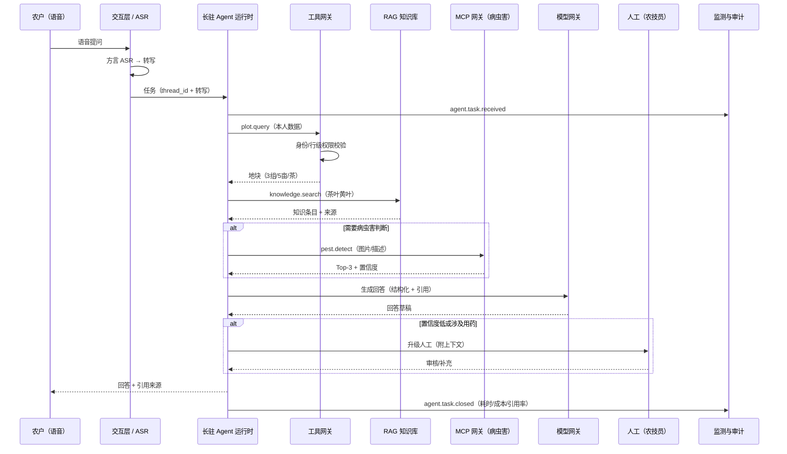

# 最小验证：一条业务 + 全套架构设计

> 目的：**不写局部代码**，用一条最小但真实感的业务，把蓝图的关键架构完整走一遍，验证设计是否成立、哪里需要改。
> 性质：设计验证（design walkthrough），不是实现、不是 UI、不是试运行。

## 一、选哪条最小业务

**场景**：农户用语音问——

> “我家 3 组那块 5 亩茶，叶子发黄怎么办？”

为什么选它：

- 是真实高频问题，业务价值明确；
- 一条链同时触及身份、数据范围、Agent、工具、RAG、模型、语音、人工升级、监测、成本、部署；
- 只读为主，不涉及资金与不可逆写操作，适合作为第一条 AI 验证；
- 不需要先把全部业务做完。

## 二、架构走查（设计态）

## 三、这条业务验证了哪些架构假设

| 架构层 | 本场景如何触发 | 通过标准 | 当前设计状态 |
| --- | --- | --- | --- |
| 交互层 | 方言语音 → 转写 | 田间噪声下可懂；老人可用 | 方案有，未实测 |
| 身份与数据范围 | 读本人地块 | 越权读取被拒；不信任客户端 uid | 设计明确 |
| Agent 运行时 | 一次多步任务、可中断 | 会话可恢复；不串话；不丢状态 | 设计明确，未实现 |
| Agent 契约 | farmer-copilot 工具白名单 | 只能读、不能审核/改他人数据 | 契约已写 |
| 编排 | 条件分支：是否查病虫害、是否升级人工 | 路由可解释；最大步数/预算生效 | LangGraph 方案明确 |
| 工具网关 | plot.query / pest.detect | 白名单、限流、审计 | 设计明确 |
| RAG | 茶叶黄叶知识检索 | 有引用；无引用则拒答/升级 | 设计明确，语料未入库 |
| MCP | 神农病虫害识别 | 经网关代理；失败可降级 | 方案明确，未接入 |
| 模型网关 | 生成回答 | 结构化输出；可换模型；成本可计量 | 设计明确 |
| 人工介入 | 低置信度/用药问题 | interrupt 暂停、人工恢复、留痕 | 设计明确 |
| 监测 | 全链路事件 | trace 可回放；任务成功率/成本可看 | 事件结构已定义 |
| 部署 | 长驻运行面 + 请求面 | 断线/重启后按 thread_id 恢复 | 方案明确，未部署 |

## 四、最小验证的判定标准

满足以下条件，才算“架构设计通过最小验证”：

1. 一次提问只读取本人地块；跨户/跨村读取被拒；
2. 回答至少引用 1 条知识条目；无引用时拒答或升级；
3. 低置信度或用药问题触发人工中断，恢复需权限；
4. 每个工具调用可在 trace 中看到参数摘要、耗时、结果状态；
5. 单次会话成本可计量，有预算上限；
6. 运行实例重启后，会话能按 thread_id 从检查点恢复；
7. 部署映射清楚：请求面走云函数，Agent 运行面走长驻容器。

## 五、当前结论

- 这条最小业务与蓝图架构**没有结构性冲突**；
- 真正的缺口不是“再写一个模块”，而是四个待验证项：方言 ASR、知识语料入库、LangGraph 运行时、神农 MCP 接入；
- `plot-submit` 切片只验证了业务底座与工程规范，**不能代表 AI 主链路**；
- 代码实现已降级为附录，不作为本次最小验证的结论。

## 六、它不是

- 不是代码实现，不是 UI，不是生产部署；
- 不是真实农户试用；
- 不是指标实测，所有数字都是设计判据。

## 七、下一步（设计态）

1. 为这条业务写 10 条 E2E 用例（正常/越权/无引用/低置信度/人工恢复/断线恢复）；
2. 定义 `plot.query`、`knowledge.search`、`pest.detect` 三个工具契约；
3. 定义 farmer-copilot 的 State 与中断点；
4. 做一次纸面演练：每条用例对照架构层，标出缺口；
5. 缺口收敛后再进入实现 spike，而不是先写代码。
